<div style="text-align: center;">

# Avance 2 | Ingeniería de características

### Construcción, normalización, selección y extracción de características sobre imágenes de anaquel

**Tecnológico de Monterrey** · Maestría en Inteligencia Artificial Aplicada<br>
**TC5035.10 — Proyecto Integrador (Grupo 10)**

**Equipo 48** · **Modalidad:** En equipo · **Fecha:** Octubre 2026

| Integrante | Matrícula |
|---|---|
| Oscar Alberto Ramírez Anaya | A01795438 |
| Germán Eduardo Rodríguez Vázquez | A01796325 |
| Jesús Soto Medrano | A01794746 |

**Profesora:** Dra. Grettel Barceló Alonso · **Asesor:** Dr. Raúl Valente Ramírez<br>
**Sponsor:** Dr. Juan Arturo Nolazco Flores · **Organización:** Bnext

</div>

---

**Entregable:** [`Avance2.48.ipynb`](./Avance2.48.ipynb) ·
[Ver en nbviewer](https://nbviewer.org/github/oscar-ramirez-anaya/Avance2_Equipo48/blob/main/Avance2.48.ipynb) ·
[Reporte PDF](./Avance2.48.pdf) · [Reporte DOCX](./Avance2.48.docx)

## Resumen

Fase de **Preparación de los datos** de CRISP-ML(Q) sobre la **muestra real** de imágenes de anaquel de
Bnext: 100 escenas de refrigeradores y vitrinas y **422 recortes de producto de 35 SKU**. Cada imagen se
convierte en un vector de variables con significado visual, se construyen variables de dominio, se
transforman y escalan, y se reduce el conjunto con filtros y métodos de extracción. Todas las decisiones
se validan con un modelo base (regresión logística) en validación cruzada por bloques.

| Indicador | Resultado |
|---|---|
| Variables construidas | **823** (geometría, calidad de captura, color, textura LBP, forma HOG y variables de dominio) |
| Asimetría absoluta media tras Box-Cox / Yeo-Johnson | **1.41 → 0.21** |
| Efecto del escalamiento (regresión logística) | F1 **0.002 → 0.973**, converge en **12** iteraciones |
| Variables seleccionadas (ANOVA) | **50 de 823** (6 %) |
| F1 macro, validación cruzada / prueba | **0.955 ± 0.016 / 0.976** |
| Tiempo de entrenamiento | **5.5 veces menor** que con todas las variables |

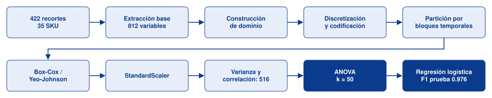

*Flujo de preparación de los datos. PCA (122 componentes) y el análisis factorial (6 factores) se evaluaron como alternativas a la selección por ANOVA.*

## Cobertura de la rúbrica

| Criterio | Dónde | Evidencia |
|---|---|---|
| **Construcción** (30) | Secciones 2 a 5 | 5 variables nuevas de dominio y 3 alertas de captura, matiz circular, discretización por dominio y por cuartiles, codificación one-hot / ordinal / LabelEncoder y exclusión justificada de una variable con fuga. |
| **Normalización** (30) | Secciones 7 a 9 | Box-Cox y Yeo-Johnson con λ y prueba de Shapiro antes y después; comparación de tres escaladores con medición de convergencia y de su efecto en kNN. |
| **Selección / extracción** (30) | Secciones 10 a 16 | Umbral de varianza, correlación, ANOVA, chi-cuadrado, información mutua, PCA y análisis factorial (KMO, Bartlett, varimax); elección de k con validación cruzada y comparativa de siete configuraciones. |
| **Conclusiones** (10) | Sección C | Conclusión de la fase de Preparación de los datos por tareas de CRISP-ML(Q), riesgos y siguiente fase. |

---

## A. Ingeniería de características

### Datos de partida

La muestra tiene una razón de desbalance de 2.4 entre el SKU con más y con menos recortes, moderada para
esta etapa. No hay valores faltantes. Los códigos de SKU se anonimizaron.

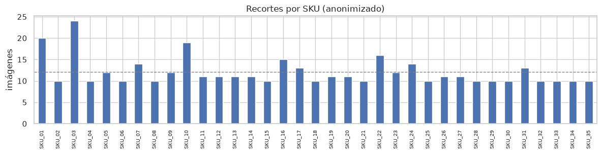

### Extracción base

| Familia | Variables | Por qué |
|---|---:|---|
| Geometría y archivo | 5 | Formato del empaque y resolución de captura |
| Exposición y calidad | 7 | Iluminación y nitidez variables en tienda (varianza del Laplaciano) |
| Color global | 14 | El color del empaque es la señal más directa entre marcas; Lab separa luz y cromaticidad |
| Histogramas HSV | 20 | Distribución de color, no solo su media |
| Textura LBP | 10 | Texto, logotipos y relieves, invariante a iluminación |
| Forma HOG | 756 | Silueta y bordes del empaque |

### Construcción de nuevas características

| Variable | Definición | Justificación |
|---|---|---|
| `kb_por_mp` | KB / megapíxeles | A igual resolución, un JPEG pesa más si tiene detalle y menos si está borroso |
| `nitidez_por_borde` | nitidez / densidad de bordes | Separa "imagen con mucho contenido" de "imagen enfocada" |
| `exposicion_ok` | 1 − \|brillo − 128\| / 128 | Distancia a una exposición centrada |
| `indice_calidad` | promedio de exposición, nitidez y contraste acotados | Resume si la captura es apta |
| `hue_x`, `hue_y` | coseno y seno del matiz | El matiz es circular: 0° y 360° son el mismo rojo |
| `flag_borrosa`, `flag_oscura`, `flag_sobreexpuesta` | umbrales de dominio | Alertas operativas de captura |

El índice de calidad separa los tipos de toma: la foto original del dispositivo obtiene 0.97 y el mueble
aislado de vitrina 0.83, porque cada recorte pierde resolución y contraste. La alerta de sobreexposición se
activa en 56 % de los recortes por las etiquetas blancas, así que debe recalibrarse por producto.

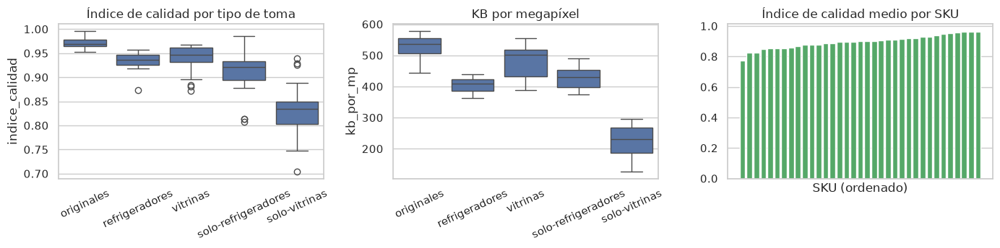

### Discretización y codificación

Iluminación y formato de empaque se discretizan con **cortes de dominio** (interpretables y estables entre
muestras); la nitidez, muy asimétrica, por **cuartiles** ajustados solo con entrenamiento. El tipo de toma se
codifica **one-hot** (nominal), las variables discretizadas como **ordinales** y el SKU con **LabelEncoder**.
La variable `fuente_captura` se **excluye**: cada SKU proviene de una sola fuente, así que revela la clase.

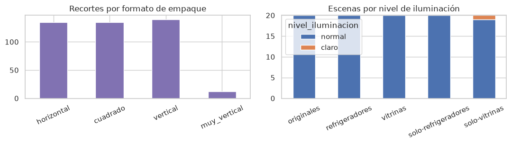

### Partición sin fuga

Las fotos de cada SKU se tomaron en ráfagas de segundos, así que recortes consecutivos son casi
duplicados. La partición es **por bloques temporales dentro de cada SKU**: 70 % inicial a entrenamiento
(304) y 30 % final a prueba (118), con las 35 clases en ambos. Todas las transformaciones se ajustan solo
con entrenamiento dentro de un `Pipeline`.

### Transformaciones

9 de 31 variables continuas tenían |asimetría| > 1. **Box-Cox** para las estrictamente positivas y
**Yeo-Johnson** para las que admiten cero o negativos.

| Variable | Método | λ | Asimetría antes | Después |
|---|---|---:|---:|---:|
| frac_subexp | Yeo-Johnson | −62.43 | 1.92 | 0.32 |
| ancho | Box-Cox | −3.02 | 1.79 | 0.64 |
| area_px | Box-Cox | −1.34 | 1.52 | 0.11 |
| entropia | Yeo-Johnson | 15.83 | −1.41 | −0.18 |
| nitidez_por_borde | Box-Cox | 0.06 | 1.24 | 0.00 |

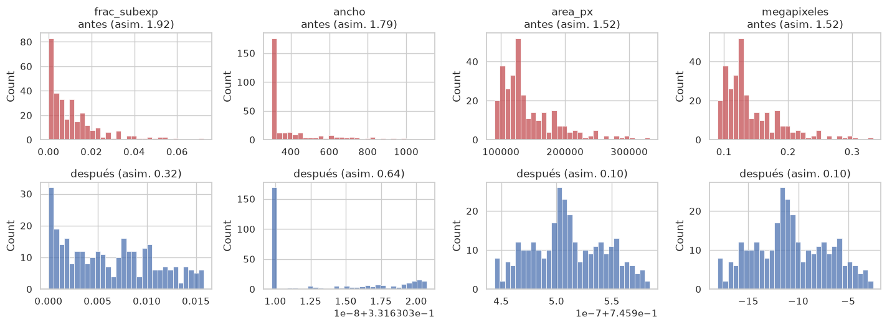

### Escalamiento

| Escalador | F1 regresión logística | Iteraciones | F1 kNN |
|---|---:|---:|---:|
| Sin escalar | 0.002 | 16 | 0.053 |
| **StandardScaler** | **0.973** | **12** | 0.918 |
| MinMaxScaler | 0.973 | 60 | 0.925 |
| RobustScaler | 0.965 | 82 | 0.964 |

Sin escalar, el modelo no aprende. **StandardScaler** converge más rápido con el mejor F1 y es el que
suponen PCA y el análisis factorial; MinMax se reserva para chi-cuadrado y el umbral de varianza.

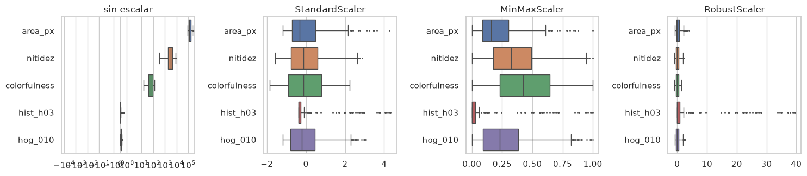

---

## B. Selección y extracción de características

### Umbral de varianza y correlación

El umbral de varianza (0.001 sobre Min-Max) elimina 2 variables constantes; el filtro de correlación de
Spearman (|ρ| > 0.95) elimina 305, sobre todo celdas HOG vecinas y variables construidas redundantes.
Quedan 516.

| Varianza | Correlación |
|---|---|
| 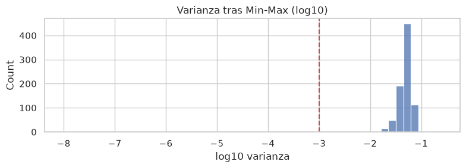 | 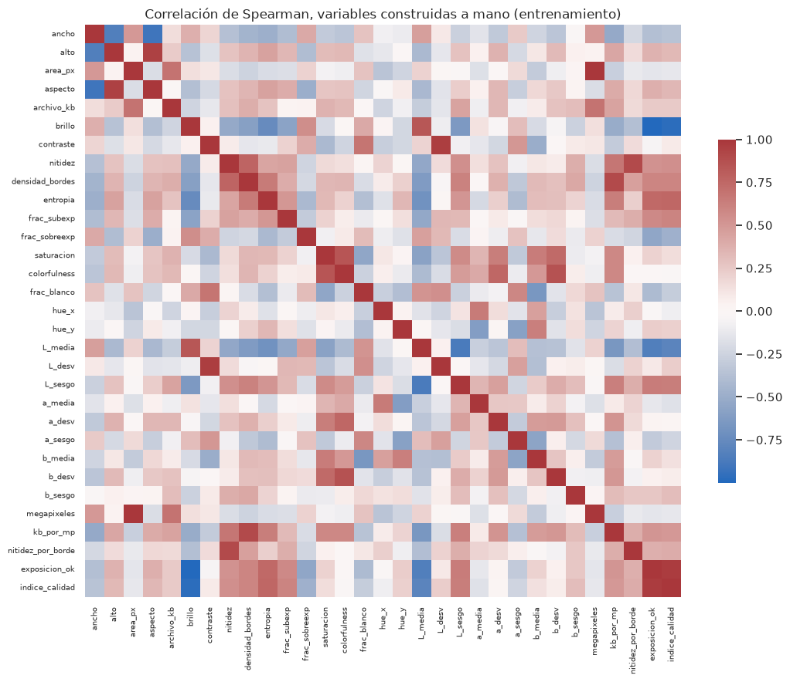 |

### ANOVA, chi-cuadrado e información mutua

Los tres criterios coinciden en que **el color domina** (histograma de matiz, Lab, matiz circular); la
forma HOG aporta 49 de las 100 variables con mayor F. Chi-cuadrado solo es adecuado para los histogramas
(supone frecuencias), por eso coincide menos con ANOVA (ρ = 0.64).

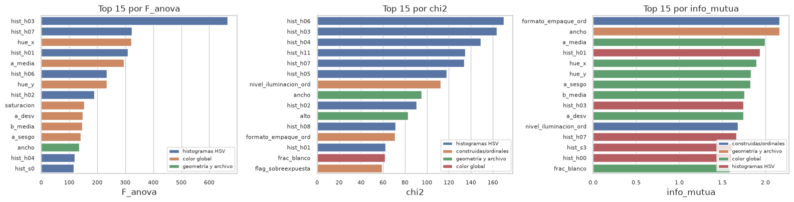

Los tres criterios alcanzan su máximo cerca de **k = 50**; con más variables el modelo sobreajusta.

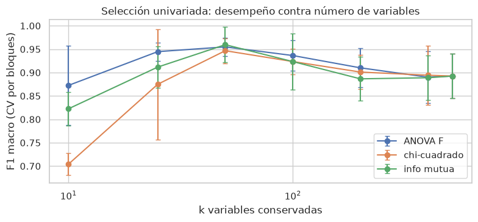

### PCA y análisis factorial

PCA necesita 122 componentes para el 95 % de la varianza. El análisis factorial sobre las 23 variables
manuales (KMO 0.69, Bartlett p < 0.001) produce 6 factores interpretables: luminosidad y calidad, eje
amarillo-azul, intensidad cromática, eje rojo-verde, resolución y textura.

| PCA | Cargas factoriales (varimax) |
|---|---|
| 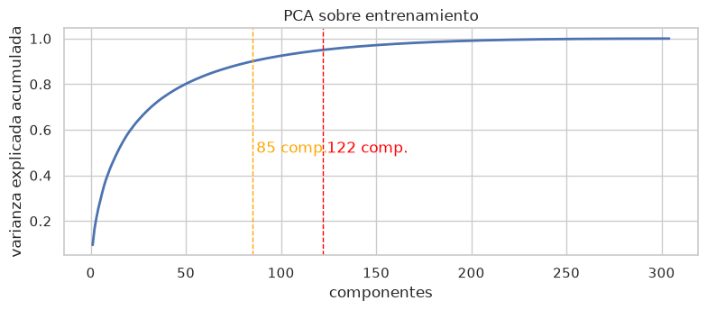 | 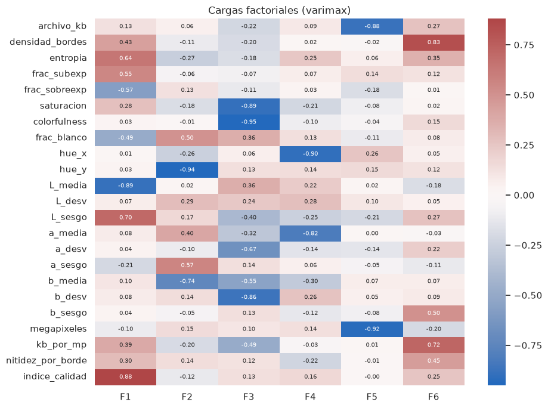 |

### Comparativa y elección

| Configuración | Variables | F1 CV | F1 prueba | Segundos |
|---|---:|---:|---:|---:|
| 1. Todas, potencia sin escalar | 823 | 0.002 | 0.002 | 2.58 |
| 2. Todas, potencia + estándar | 823 | 0.882 ± 0.034 | 0.973 | 1.53 |
| 3. + varianza + correlación | 516 | 0.893 ± 0.039 | 0.964 | 1.73 |
| **4. + ANOVA (k = 50)** | **50** | **0.955 ± 0.016** | **0.976** | **0.28** |
| 5. PCA 95 % | 122 | 0.887 ± 0.047 | 0.964 | 0.43 |
| 6. Solo manuales | 23 | 0.904 ± 0.022 | 0.927 | 0.17 |
| 7. Factores del análisis factorial | 6 | 0.812 ± 0.044 | 0.821 | 0.27 |

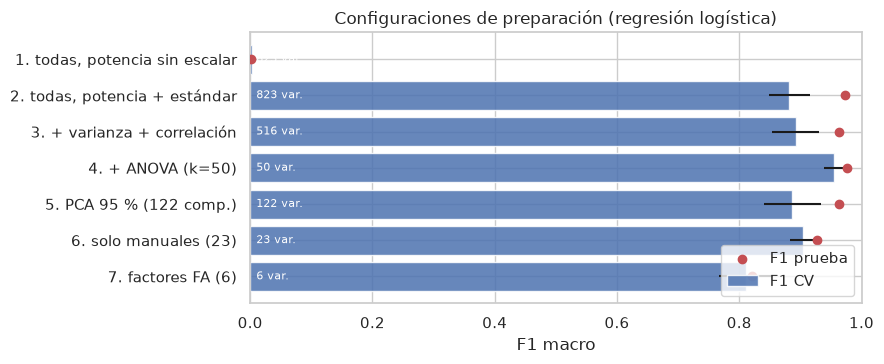

**Se elige la configuración 4**: mejor y más estable en validación cruzada, confirmada en prueba, con el 6 %
de las variables y entrenamiento 5.5 veces más rápido.

---

## C. Conclusiones de la fase de Preparación de los datos (CRISP-ML(Q))

1. **Selección:** muestra real dentro de la infraestructura de Bnext, 35 SKU con desbalance moderado.
2. **Limpieza y calidad:** sin faltantes; capturas nítidas y bien iluminadas; la alerta de sobreexposición
   requiere recalibrarse por producto; se descartó una variable con fuga de información.
3. **Construcción:** de píxeles a 823 variables con significado visual más variables de dominio,
   discretizaciones y codificaciones justificadas.
4. **Estandarización:** asimetría media de 1.41 a 0.21; convergencia en 12 iteraciones y kNN de 0.05 a
   0.92 de F1.
5. **Reducción:** 50 variables (6 %) con mejor validación (0.955 contra 0.882) y 5.5 veces menos tiempo.
6. **Aseguramiento de calidad:** partición por bloques temporales sin fuga, transformaciones ajustadas solo
   con entrenamiento, semilla fija y artefactos guardados en el servidor.

**Riesgos para el modelado:** la muestra es pequeña y cada SKU viene de una sola sesión de captura, así que
las métricas miden separabilidad, no generalización a otras tiendas o dispositivos. **Siguiente fase:**
entrenar modelos de clasificación y detección contra esta línea base y solicitar más sesiones de captura
por SKU.

---

## Contenido del repositorio

| Archivo | Descripción |
|---|---|
| **`Avance2.48.ipynb`** | Libreta ejecutada de principio a fin, en secuencia, con salidas y gráficos |
| `Avance2.48.pdf` / `Avance2.48.docx` | Reporte del avance (17 páginas) |
| `Avance2.48.html` | Fuente del PDF |
| `figuras/` | Gráficas exportadas de la libreta |
| `scripts/construir_avance2.py` | Genera la libreta (interpretaciones en `avance2_textos.json`) |
| `scripts/generar_documento_avance2.py` | Genera HTML, PDF y DOCX con las figuras de la libreta ejecutada |
| `scripts/verificar_publicacion.py`, `.githooks/` | Verificación previa a cada commit |
| `POLITICA_DATOS.md` | Acuerdo de manejo de datos con Bnext |

## Manejo de datos

La libreta se ejecutó dentro del servidor de Bnext conforme a [`POLITICA_DATOS.md`](POLITICA_DATOS.md).
Las imágenes, las tablas de características y el pipeline ajustado permanecen en esa infraestructura. Este
repositorio contiene solo código, gráficas y tablas agregadas; los SKU están anonimizados.

## Reproducir

```bash
python3 scripts/construir_avance2.py
# en el servidor de Bnext:
export PLANOGRAMA_DATA_DIR=<muestra> PLANOGRAMA_OUT_DIR=<salidas>
jupyter nbconvert --to notebook --execute --inplace Avance2.48.ipynb
# de vuelta en el repositorio:
python3 scripts/generar_documento_avance2.py
```

## Referencias

- Galli, S. (2022). *Python feature engineering cookbook* (2a ed.). Packt Publishing.
- Visengeriyeva, L., Kammer, A., Bär, I., Kniesz, A., y Plöd, M. (2023). *CRISP-ML(Q). The ML lifecycle process*. MLOps. INNOQ. https://ml-ops.org/content/crisp-ml
- Box, G. E. P., y Cox, D. R. (1964). An analysis of transformations. *Journal of the Royal Statistical Society: Series B, 26*(2), 211–252.
- Yeo, I.-K., y Johnson, R. A. (2000). A new family of power transformations to improve normality or symmetry. *Biometrika, 87*(4), 954–959.
- Dalal, N., y Triggs, B. (2005). Histograms of oriented gradients for human detection. *CVPR 2005*, 886–893.
- Ojala, T., Pietikäinen, M., y Mäenpää, T. (2002). Multiresolution gray-scale and rotation invariant texture classification with local binary patterns. *IEEE TPAMI, 24*(7), 971–987.
- Kaiser, H. F. (1974). An index of factorial simplicity. *Psychometrika, 39*(1), 31–36.

La bibliografía completa está en el reporte PDF.
